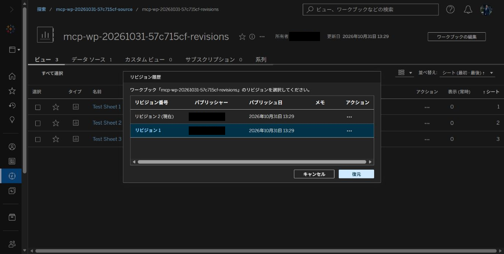
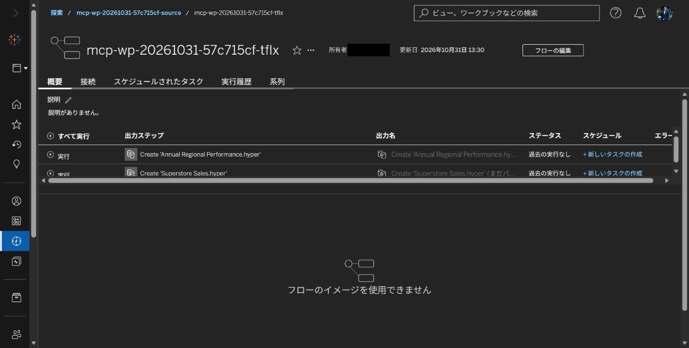
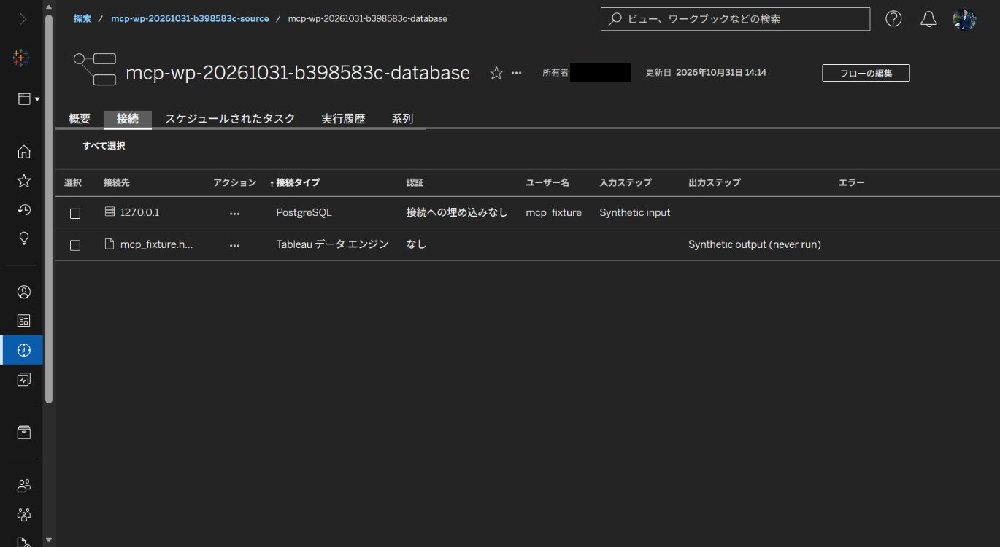
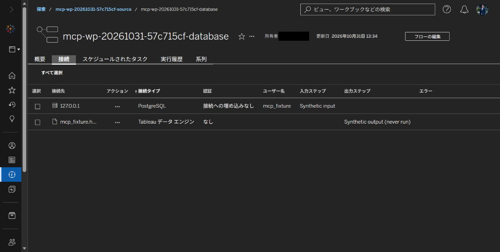

# Workbook and Prep live verification — 2026-10-31

The five PR runtimes were tested against Tableau Cloud using disposable, session-owned content. Feature calls used MCP; independent REST reads checked identity and returned bytes. REST fixture creation and UI screenshots are supporting evidence only. Owner and publisher names are hidden with opaque black rectangles before any image is saved. Each PNG was visually reviewed; no unmasked original was saved.

| Feature | PR | Verified source commit | Runtime SHA256 |
| --- | --- | --- | --- |
| workbook-revisions | [#1171](https://github.com/tableau/tableau-mcp/pull/1171) | `25e2543f3b7122ce89f9dbac1e2a1747acb97bca` | `9f772b718738fc97ffc66a842bed0159edbe96db7c44303e6de8c7d9efa06dd4` |
| download-flow | [#1172](https://github.com/tableau/tableau-mcp/pull/1172) | `601d93bc8b8740fda38351c2ebaf3a03ddcbe39c` | `dd966d6aa55d07ec5239d8f7c975fff9d2492a74b27968d717e2d7d4bd4dcc92` |
| publish-flow | [#1173](https://github.com/tableau/tableau-mcp/pull/1173) | `a0ab09f883e4f9b818f2dede83cbe912660ff1e4` | `f49847ac8ea984362b8c55056d9f7e019a6d239bbb078bd70edfbab7a503e44c` |
| move-flow | [#1174](https://github.com/tableau/tableau-mcp/pull/1174) | `f8427081cfd4046303ce8c580e9eb232a6011b6b` | `9a9700413edf1bc0c93ae40be36d984ecfd85f6e6c1f85f15c69f9cb98a18f03` |
| update-flow-connection | [#1175](https://github.com/tableau/tableau-mcp/pull/1175) | `dbbc7514d799e3451b8a0089fb1437113519b785` | `90a2f9faa319af607f9563003c828cdf38af51818b607cdb318935af1c0aca5b` |

## Measured live results

- **Past workbook revision:** session `57c715cf` listed two revisions and downloaded revision 1 through MCP. The 21420-byte file matched an independent REST download, SHA256 `181e99a5ddf4c0c9184ba1c415ed0c8809038445eac4ba83b336a7e74077f25f`. Revision 2 stayed current; workbook identity and revision history were unchanged. The source and downloaded XML have no managed extract nodes and use a live Hyper datasource. Managed-extract exclusion was not exercised.
- **Native TFL download:** session `b398583c` published a synthetic database flow and downloaded the server's native `.tfl` through MCP. All 2302 bytes matched the independent REST response, SHA256 `ca1bbc03c7710ce524abe870e505079ca24db4d181cb23a64013b810da2cb02d`. Server file identity was preserved.
- **TFLX download:** session `57c715cf` downloaded the published `.tflx` through MCP. All 960205 bytes matched independent REST, SHA256 `e4af11b5e08c7d5332ce7ae177a556942a544bb2c22e4791a9db3a88cd0af204`.
- **Publication:** session `57c715cf` published both `.tfl` and `.tflx` inputs through MCP, with independent project/owner readback and subsequent byte-equal MCP/REST downloads. The file-based TFL input was normalized by the server to TFLX (13951 bytes, SHA256 `c04105ef04057d633e4cd2e31bb4e5351a5cb18a35d26fb677ba444cdc983250`). The synthetic database input remained native TFL, also confirmed in session `b398583c`.
- **Project move:** session `258bedb7` moved the owned TFLX flow to the second disposable project through MCP and restored it through MCP, with independent project/owner readback after each call. Its [immutable screenshots and record](https://github.com/mickitty0511/tableau-mcp/blob/978cd4e03e87d4c060c6a789689e47434d7f1e83/docs/verification/workbook-prep-20261031/README.md) retain the same source/runtime hashes listed above.
- **Connection endpoint:** session `57c715cf` changed the owned PostgreSQL connection from `127.0.0.1` to documentation address `192.0.2.10` through MCP, independently read it back, and restored `127.0.0.1` through MCP with another readback. This checks saved connection metadata; it does not test database connectivity. No flow was executed.

## Reviewed screenshots

The revision dialog shows revision 1 selected and revision 2 marked current. No Restore action was used. Flow images show the exact disposable content after the recorded MCP calls; file-format and byte equality are established by the MCP/REST results above.

### Past revision selected; current version preserved

SHA256: `fe972e6db011699babb8d1fb38e81da77b5f57d1cace40e94231e9dd04617a9a`.

### Published TFLX flow after the MCP download comparison

SHA256: `dc0affbfeff5ffadad95faffc7b2c3e292591b59ba6db0981d71d515a21d93cb`.

### Native TFL database flow after publication and download

SHA256: `b3ebb2079888c2c89bd92986bed7fe52597990acadb69db2c494f3b6eabc2140`.

### Connection endpoint changed through MCP

SHA256: `4b790dd4ca1b8a1a096a316bd07f8dfb369973b29aacfe0c607e227f128984c8`.

### Connection endpoint restored through MCP

SHA256: `9bad4ebc78046362248ab7f1b0b8c135e7215ebe0d73a888796f33a53fdcd11a`.

## Scope limits

These are PAT-based tests of the stated fixtures and source commits. Hosted storage, alternate authentication and every permission-denial variant were not exercised live. Focused automated checks are documented separately in each PR. Upstream CI execution approval and maintainer review remain required; no upstream merge or CI pass is asserted by these images.
